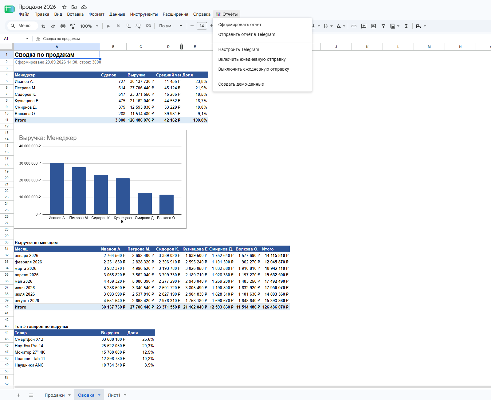
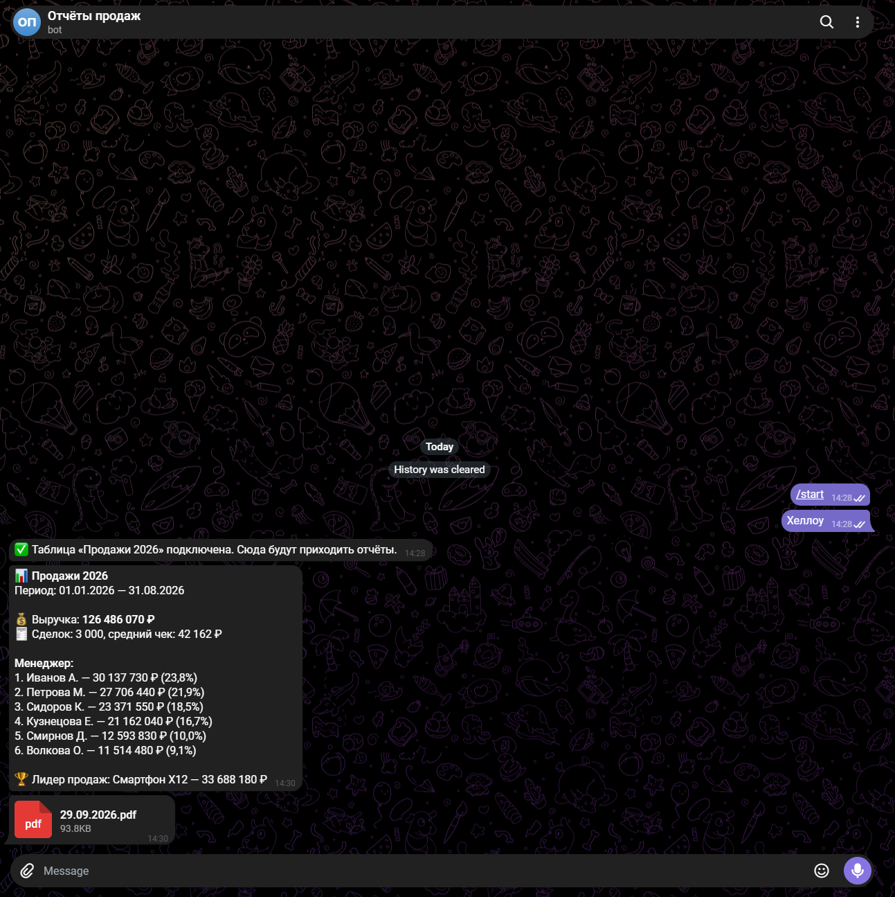

# Отчёт по продажам в Google Таблицах + отправка в Telegram

Скрипт Google Apps Script: из таблицы продаж одной кнопкой строится отчёт, а итоги приходят в Telegram — по кнопке или автоматически каждое утро. Работает на серверах Google: компьютер можно не включать.

<!-- Сюда добавить демо: docs/demo.gif, docs/sheet.png, docs/telegram.png -->




## Возможности

**Меню «📊 Отчёты» прямо в таблице**
- **Сформировать отчёт** — лист «Сводка»: итоги по менеджерам (сделки, выручка, средний чек, доля), диаграмма, выручка по месяцам, топ-5 товаров
- **Отправить отчёт в Telegram** — короткая сводка сообщением + весь лист «Сводка» PDF-файлом с диаграммой
- **Ежедневная отправка** — отчёт приходит в Telegram каждое утро без участия человека
- **Настроить Telegram** — подключение за минуту: вставить токен бота и написать ему сообщение, chat id определяется автоматически. Можно отправлять в личку или в рабочую группу

**Надёжность**
- Исходные данные не меняются, лист отчёта пересоздаётся при каждом запуске
- Пустые строки и незаполненные ячейки не ломают расчёт
- Токен бота хранится в защищённых свойствах скрипта, а не в ячейках таблицы
- Названия листа и колонок вынесены в настройки в начале кода — скрипт легко подключить к любой таблице

## Пример сообщения в Telegram

```
📊 Продажи 2026
Период: 01.01.2026 — 31.08.2026

💰 Выручка: 127 519 700 ₽
🧾 Сделок: 3 000, средний чек: 42 507 ₽

Менеджер:
1. Иванов А. — 33 367 440 ₽ (26,2%)
2. Петрова М. — 27 654 020 ₽ (21,7%)
...

🏆 Лидер продаж: Смартфон X12 — 30 641 240 ₽
```

## Установка

1. Создайте Google Таблицу.
2. **Расширения → Apps Script**. Замените содержимое файла `Code.gs` кодом из этого репозитория.
3. В настройках проекта (значок шестерёнки) включите **«Показывать файл манифеста appsscript.json»** и замените его содержимое файлом из репозитория.
4. Сохраните проект и обновите страницу таблицы — появится меню **«📊 Отчёты»**.
5. При первом запуске Google попросит разрешения. Это собственный скрипт, поэтому Google покажет предупреждение «Приложение не проверено»: нажмите **«Дополнительные настройки» → «Перейти на страницу…»** → **«Разрешить»**.
6. **«📊 Отчёты» → «Создать демо-данные»**, затем **«Сформировать отчёт»**.

## Как подключить к своей таблице

В начале `Code.gs` поменяйте настройки `CONFIG`: имя листа с данными, названия колонок с суммой, датой, менеджером и товаром, час ежедневной отправки.

## Стек

Google Apps Script (JavaScript) · Google Sheets · Telegram Bot API

---

Нужна автоматизация Google Таблиц под вашу задачу — импорт данных, уведомления, отчёты по расписанию, связь с другими сервисами? Пишите.
